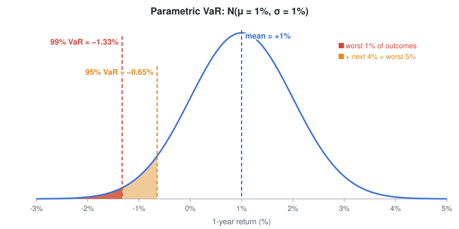
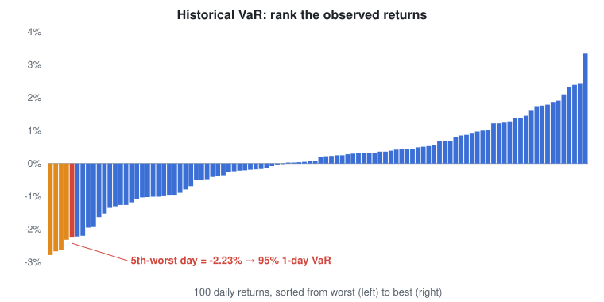

# Value at Risk (VaR)

Notes from a short video on VaR, plus a few sources to check against.

## What it is

VaR is how much you could lose on an asset or a portfolio over a set period, at a set confidence level.

You pick two things: a **time period** and a **confidence level**. What you get back is a **potential loss**.

One thing to keep in mind is that VaR is a threshold, not a worst case. Losses can go past it. VaR just tells you that won't happen often [[1]](#sources).

## Worked example

- Time period: 1 year
- Mean return: 1%
- Standard deviation: 1%

The formula:

```
VaR = mean − z × standard deviation
```

`z` comes from a standard normal table. It's 1.645 at 95% and 2.326 at 99% [[3]](#sources). The video rounds these to 1.65 and 2.33.

| Confidence | z | VaR |
|---|---|---|
| 95% | 1.65 | 1% − 1.65 × 1% = **−0.65%** |
| 99% | 2.33 | 1% − 2.33 × 1% = **−1.33%** |



At 95% confidence, you don't expect to lose more than 0.65% over the year. Anything worse falls in the 5% tail on the left. When you raise the confidence to 99%, the cut-off moves further into the tail and the potential loss gets bigger.

(In the video he says "1 minus negative 2.33" at the 99% step. That's a slip. It should be 1% − 2.33 × 1%, and his answer of −1.33% is right.)

## Three ways to calculate it

**1. Parametric (variance-covariance).**
You assume a mean, a standard deviation and a distribution (usually normal), then plug them into the formula above. That's what the example did [[2]](#sources).

**2. Historical.**
This is the easiest one to follow. Take your past returns, say the last 100 days, and sort them from worst to best. For 95% VaR, the 5th-worst day is your answer [[2]](#sources). You don't have to assume any distribution, because you're just using what actually happened.



*(The returns in this chart are made up for illustration.)*

**3. Monte Carlo.**
You set your assumptions (mean, standard deviation, distribution) and have a computer simulate lots of possible outcomes, for example 1,000. Then you sort the results and read off the percentile you need, like the 5th percentile for 95% VaR [[2]](#sources).

## Sources

1. Wikipedia, *Value at risk*: https://en.wikipedia.org/wiki/Value_at_risk
2. Corporate Finance Institute, *Value at Risk (VaR)*: https://corporatefinanceinstitute.com/resources/knowledge/finance/value-at-risk-var
3. NIST/SEMATECH e-Handbook of Statistical Methods, critical values table: https://www.itl.nist.gov/div898/handbook/eda/section3/eda3672.htm
