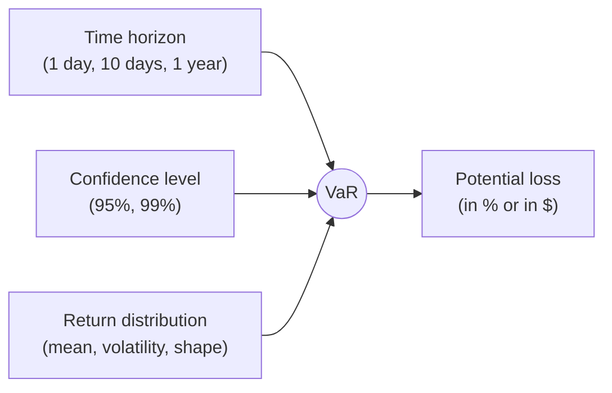
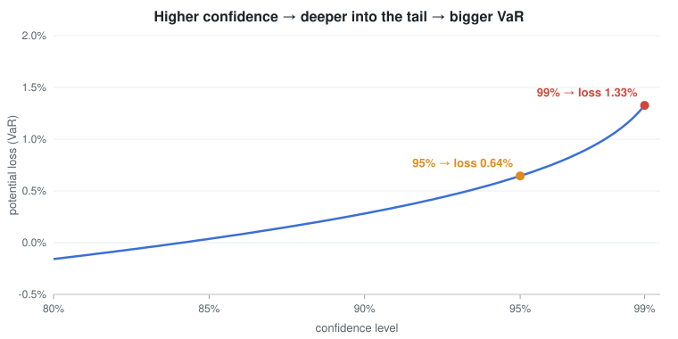
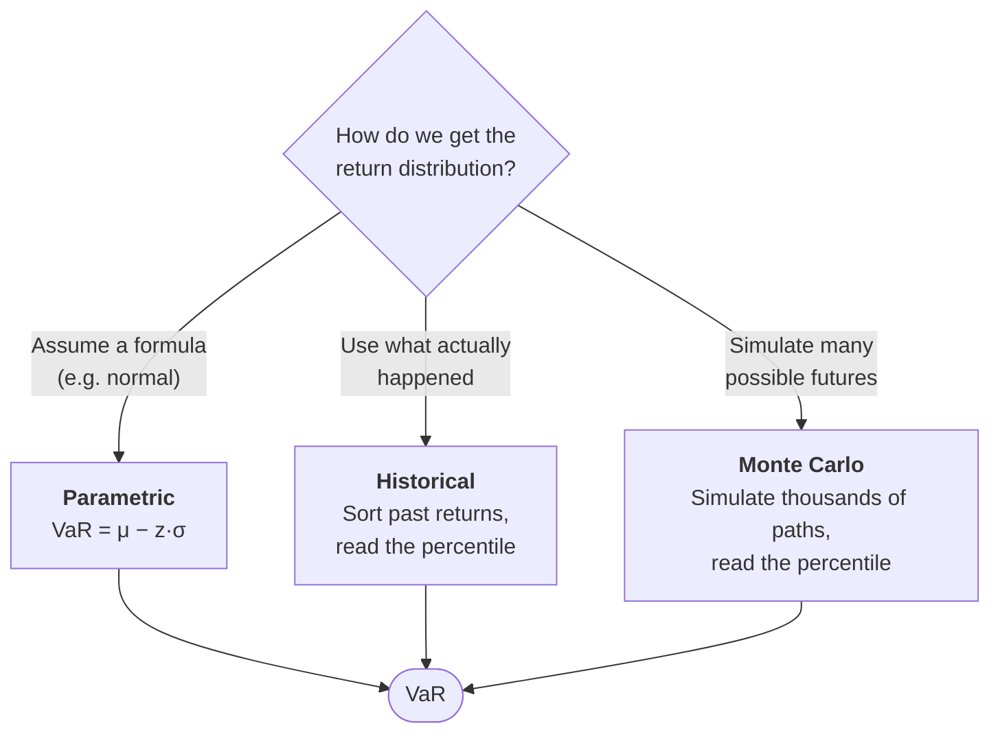
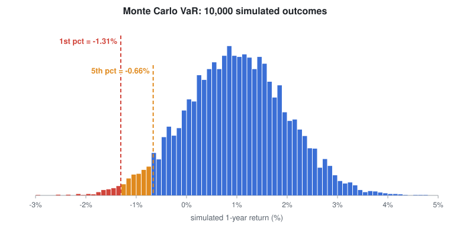
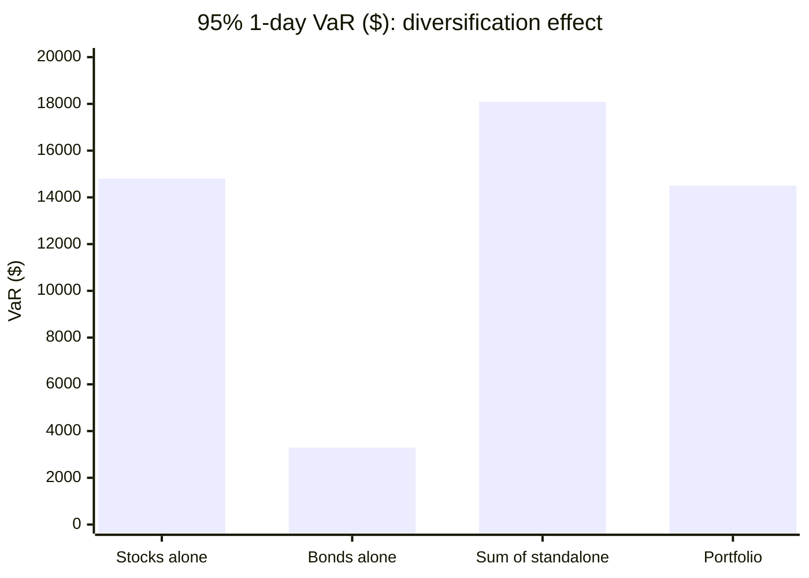
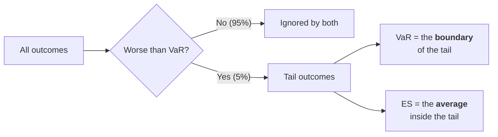

# Value at Risk (VaR)

How to measure the potential loss on a risky asset or portfolio, with the maths, worked examples and pictures.

---

## Contents

1. [Definition](#1-definition)
2. [The maths behind it](#2-the-maths-behind-it)
3. [Worked example from the video](#3-worked-example-from-the-video)
4. [Three ways to estimate VaR](#4-three-ways-to-estimate-var)
5. [More worked examples](#5-more-worked-examples)
6. [Beyond VaR: Expected Shortfall](#6-beyond-var-expected-shortfall)
7. [Checking a VaR model: backtesting](#7-checking-a-var-model-backtesting)
8. [Limitations and common mistakes](#8-limitations-and-common-mistakes)
9. [Cheat sheet](#9-cheat-sheet)

---

## 1. Definition

> **Value at Risk** is the potential loss in value of a risky asset or portfolio over a **specified time period**, at a **specified confidence level**.

You can read any VaR figure as a single sentence:

> *"Over the next **[time horizon]**, we are **[confidence]%** confident that we will not lose more than **[VaR]**."*

For example, a one-day 99% VaR of \$1 million means:

- On **99 days out of 100**, the loss should be smaller than \$1M.
- On about **1 day in 100**, the loss is expected to be **larger** than \$1M.

VaR does **not** tell you how much larger. That is the job of Expected Shortfall ([section 6](#6-beyond-var-expected-shortfall)).

---

## 2. The maths behind it

### 2.1 VaR as a quantile

Let $R$ be the return over the horizon. VaR at confidence level $c$ (for example $c = 95\%$) is the return threshold that $R$ falls below only with probability $\alpha = 1 - c$:

$$
P\left(R \le \text{VaR}_c\right) = \alpha = 1 - c
$$

In other words, **VaR is the $\alpha$-quantile (percentile) of the return distribution**. At 95% it is the 5th percentile, and at 99% it is the 1st percentile.

### 2.2 The normal (parametric) formula

If returns are normally distributed, $R \sim \mathcal{N}(\mu, \sigma^2)$, then the quantile has a closed form:

$$
\boxed{\text{VaR}_c = \mu - z_c \, \sigma}
$$

| Symbol | Meaning |
|---|---|
| $\mu$ | expected (mean) return over the horizon |
| $\sigma$ | standard deviation (volatility) over the horizon |
| $z_c$ | number of standard deviations from the mean for confidence $c$, from the standard normal table |

**Where does the formula come from?** Standardise $R$:

$$
Z = \frac{R - \mu}{\sigma} \sim \mathcal{N}(0, 1)
\quad\Rightarrow\quad
P\left(Z \le -z_c\right) = 1 - c
\quad\Rightarrow\quad
R = \mu - z_c\,\sigma
$$

### 2.3 Common z-scores

| Confidence $c$ | Tail $\alpha$ | $z_c$ (exact) | Rounded value used in the video |
|---|---|---|---|
| 90% | 10% | 1.2816 | 1.28 |
| 95% | 5% | 1.6449 | **1.65** |
| 97.5% | 2.5% | 1.9600 | 1.96 |
| 99% | 1% | 2.3263 | **2.33** |
| 99.9% | 0.1% | 3.0902 | 3.09 |

### 2.4 From a % to a dollar amount

$$
\text{VaR}_{\$} = \text{Portfolio value} \times \text{VaR}_{\%}
$$

Risk managers usually **quote VaR as a positive number** ("VaR is \$19,238"). The formula above gives a **return** (often negative). These are two sign conventions for the same quantity, so always check which one is in use.

### 2.5 Changing the horizon: the square-root-of-time rule

If daily returns are independent and identically distributed, the mean scales with time and the volatility scales with the **square root** of time:

$$
\mu_T = T \, \mu_{1}, \qquad \sigma_T = \sqrt{T}\,\sigma_{1}
$$

so

$$
\text{VaR}_{T} = T\mu_1 - z_c\,\sqrt{T}\,\sigma_1
\;\;\approx\;\; \sqrt{T}\,\text{VaR}_1 \quad (\text{when } \mu \approx 0)
$$

This is why the Basel 10-day VaR is often computed as $\sqrt{10} \approx 3.16$ times the 1-day VaR.

---

## 3. Worked example from the video

**Inputs**

| Parameter | Value |
|---|---|
| Time horizon | 1 year |
| Expected (mean) return $\mu$ | 1% |
| Standard deviation $\sigma$ | 1% |

**At 95% confidence** ($z = 1.65$):

$$
\text{VaR}_{95\%} = 1\% - 1.65 \times 1\% = \mathbf{-0.65\%}
$$

**At 99% confidence** ($z = 2.33$):

$$
\text{VaR}_{99\%} = 1\% - 2.33 \times 1\% = \mathbf{-1.33\%}
$$

**How to read it**

- With 95% confidence, you do not expect to lose more than **0.65%** over the year. Outcomes worse than that make up the shaded 5% tail.
- Moving from 95% to 99% confidence pushes the cut-off **further into the tail**, so the potential loss grows to **1.33%**.

The curve gets steeper near the right edge. Going from 95% to 99% costs much more than going from 90% to 95%, because the normal tails thin out quickly.

> **Note on the video:** at the 99% step the presenter says "1 minus negative 2.33". That is a slip of the tongue. The correct calculation is $1\% - 2.33 \times 1\%$, and the final answer of $-1.33\%$ is right.

---

## 4. Three ways to estimate VaR

### 4.1 Parametric (variance-covariance) method

**Idea:** assume a distribution (usually normal), estimate its mean and standard deviation, then plug them into $\mu - z\sigma$. This is what the worked example in [section 3](#3-worked-example-from-the-video) did.

**Steps**

1. Estimate $\mu$ and $\sigma$ from data (for a portfolio, also the correlations between assets).
2. Look up $z_c$ for the confidence level.
3. Compute $\text{VaR} = \mu - z_c\sigma$, then scale it to dollars.

For a portfolio with weight vector $\mathbf{w}$ and covariance matrix $\Sigma$:

$$
\sigma_p = \sqrt{\mathbf{w}^\top \Sigma \, \mathbf{w}}
$$

With two assets this becomes:

$$
\sigma_p^2 = w_1^2\sigma_1^2 + w_2^2\sigma_2^2 + 2\,w_1 w_2\,\rho_{12}\,\sigma_1\sigma_2
$$

| Pros | Cons |
|---|---|
| Very fast, closed-form | Assumes normality, so it **underestimates fat tails** |
| Easy to break down by asset | Poor fit for options and other non-linear payoffs |

### 4.2 Historical simulation

**Idea:** let past data speak for itself. The presenter calls this the easiest method to understand.

**Steps**

1. Collect the last $N$ returns (for example $N = 100$ days).
2. Sort them **from worst to best**.
3. For a tail of $\alpha$, take the observation at rank $\alpha \times N$.
   - $N = 100$ and 95% confidence: the **5th-worst** day is the VaR.
   - $N = 100$ and 99% confidence: the **worst** day is the VaR.

In this sample of 100 days, the five worst returns were:

| Rank | 1 | 2 | 3 | 4 | **5** |
|---|---|---|---|---|---|
| Return | −2.78% | −2.67% | −2.63% | −2.32% | **−2.23%** |

So the **95% one-day historical VaR is −2.23%**. On a \$1,000,000 portfolio that is a VaR of **\$22,300**.

| Pros | Cons |
|---|---|
| No distribution assumption; fat tails are captured automatically | Only as good as the window: no crash in the data means no crash in the VaR |
| Simple to explain to anyone | Needs a lot of data for high confidence (99.9% needs more than 1,000 observations) |
| Handles non-linear instruments by repricing | Weights all past days equally, even very old ones |

> **Convention detail:** some practitioners take the 5th-worst value, others the 6th, and others interpolate between them. With small samples these choices give noticeably different answers, so document which one you use.

### 4.3 Monte Carlo simulation

**Idea:** define a model for returns, let the computer generate thousands of possible outcomes, and read the percentile from the simulated results.

**Steps**

1. Choose the assumptions: mean, standard deviation, distribution (normal, Student-t, GARCH, ...) and correlations.
2. Draw a large number of random scenarios (the video uses 1,000; 10,000 or more is common).
3. Revalue the portfolio in each scenario.
4. Sort the simulated P&L and read the $\alpha$-percentile.

Here is the video's example ($\mu = 1\%$, $\sigma = 1\%$, normal) simulated **10,000 times**:

| | Analytical (formula) | Monte Carlo (10,000 runs) |
|---|---|---|
| 95% VaR | −0.645% | **−0.66%** |
| 99% VaR | −1.326% | **−1.31%** |

The simulated values land very close to the formula. The small gap is **sampling noise**, and it shrinks as the number of simulations grows (roughly as $1/\sqrt{n}$).

| Pros | Cons |
|---|---|
| Very flexible: any distribution, path-dependent products, options | Computationally heavy |
| Captures non-linearity | Only as good as the model you feed it ("garbage in, garbage out") |
| | Results change slightly from run to run |

### 4.4 Side-by-side comparison

| | Parametric | Historical | Monte Carlo |
|---|---|---|---|
| Distribution | Assumed (normal) | Empirical (past data) | Assumed, any shape |
| Speed | ⚡ Fastest | Fast | 🐢 Slowest |
| Fat tails | ❌ Missed | ✅ If they are in the data | ✅ If they are in the model |
| Options / non-linear | ❌ Poor | ✅ Good | ✅ Best |
| Ease of explanation | Medium | ✅ Easiest | Hardest |

---

## 5. More worked examples

### Example A: one-day and ten-day VaR in dollars

A \$1,000,000 equity portfolio has a daily mean return of 0.05% and a daily volatility of 1.2%.

**One-day, 95% VaR**

$$
\text{VaR}_{95\%} = 0.05\% - 1.645 \times 1.2\% = -1.924\% \;\Rightarrow\; \$1{,}000{,}000 \times 1.924\% \approx \mathbf{\$19{,}238}
$$

**Ten-day, 95% VaR** (square-root-of-time rule)

$$
\mu_{10} = 10 \times 0.05\% = 0.5\%, \qquad \sigma_{10} = \sqrt{10}\times 1.2\% = 3.795\%
$$

$$
\text{VaR}_{95\%,10d} = 0.5\% - 1.645 \times 3.795\% = -5.742\% \;\Rightarrow\; \approx \mathbf{\$57{,}418}
$$

| | 1-day | 10-day |
|---|---|---|
| 95% | \$19,238 | \$57,418 |
| 99% | \$27,416 | \$83,279 |

### Example B: diversification in a two-asset portfolio

| Asset | Position | Daily $\sigma$ |
|---|---|---|
| Stocks | \$600,000 (60%) | 1.5% |
| Bonds | \$400,000 (40%) | 0.5% |

The correlation between them is $\rho = -0.2$. Take the mean as 0.

**Portfolio volatility**

$$
\sigma_p^2 = 0.6^2(1.5)^2 + 0.4^2(0.5)^2 + 2(0.6)(0.4)(-0.2)(1.5)(0.5) = 0.810 + 0.040 - 0.072 = 0.778
$$

$$
\sigma_p = \sqrt{0.778} \approx 0.882\%
$$

**95% VaR, standalone versus combined**

| | Calculation | VaR |
|---|---|---|
| Stocks alone | $600{,}000 \times 1.645 \times 1.5\%$ | \$14,804 |
| Bonds alone | $400{,}000 \times 1.645 \times 0.5\%$ | \$3,290 |
| **Sum of standalone VaRs** | | **\$18,093** |
| **Portfolio VaR** | $1{,}000{,}000 \times 1.645 \times 0.882\%$ | **\$14,508** |
| **Diversification benefit** | | **\$3,585** |

Because the two assets do not move perfectly together, the risk of the whole portfolio is **less than the sum of its parts**.

### Example C: interpreting a bank's VaR report

> *"Our one-day 99% trading VaR is \$50 million."*

- On a typical trading day, losses should stay below \$50M.
- Over a year of about 250 trading days, you should **expect about 2 to 3 days** ($250 \times 1\% = 2.5$) where losses **exceed** \$50M.
- Seeing 2 or 3 such days is **not** a model failure. That is exactly what 99% means. Seeing 10 such days would be a failure (see [section 7](#7-checking-a-var-model-backtesting)).

---

## 6. Beyond VaR: Expected Shortfall

VaR answers *"how bad can things get on a normal bad day?"* It says nothing about **how bad the tail days are**. Two portfolios can share the same VaR and still have very different crash losses.

**Expected Shortfall (ES)**, also called **Conditional VaR (CVaR)**, is the **average loss on the days when VaR is exceeded**:

$$
\text{ES}_c = \mathbb{E}\left[\,R \;\middle|\; R \le \text{VaR}_c\,\right]
$$

For a normal distribution:

$$
\text{ES}_c = \mu - \sigma\,\frac{\varphi(z_c)}{1 - c}
$$

where $\varphi$ is the standard normal density function.

| Example | VaR 95% | ES 95% |
|---|---|---|
| Video example ($\mu = 1\%$, $\sigma = 1\%$) | −0.65% | **−1.06%** |
| Historical sample (100 days) | −2.23% | **−2.53%** (average of the 5 worst days) |
| Example A, one-day (mean taken as 0) | \$19,738 | **\$24,753** |

ES is always at least as severe as VaR. Since Basel III (FRTB), regulators use **97.5% ES** instead of 99% VaR for bank trading books.

---

## 7. Checking a VaR model: backtesting

A VaR model makes a testable prediction: at 99%, losses should exceed VaR on about **1% of days**. Backtesting counts the actual **exceptions** (days when the loss exceeded VaR) and compares them with that prediction.

**Basel "traffic light" test** (99% VaR, 250 trading days, 2.5 exceptions expected):

| Exceptions | Zone | Meaning |
|---|---|---|
| 0–4 | 🟢 Green | Model is acceptable |
| 5–9 | 🟡 Yellow | Model is questionable; higher capital multiplier |
| 10+ | 🔴 Red | Model is rejected |

**Kupiec proportion-of-failures (POF) test.** With $x$ exceptions out of $T$ days and expected exception rate $p = 1 - c$:

$$
LR_{POF} = -2\ln\!\left[\frac{(1-p)^{T-x}\,p^{x}}{\left(1-\frac{x}{T}\right)^{T-x}\left(\frac{x}{T}\right)^{x}}\right] \sim \chi^2_1
$$

Reject the model at the 5% significance level if $LR_{POF} > 3.84$.

---

## 8. Limitations and common mistakes

| Pitfall | Why it matters |
|---|---|
| **VaR is not the worst case** | It is a threshold, not a maximum. Losses beyond VaR can be much larger. |
| **Normality assumption** | Real returns have **fat tails**. Market crashes are far more common than a normal distribution predicts, so parametric VaR tends to understate risk. |
| **Correlations break in crises** | Assets that usually diversify each other tend to fall together in a crash, so the diversification benefit disappears exactly when it is needed. |
| **Not sub-additive** | VaR(A + B) can exceed VaR(A) + VaR(B), which can penalise diversification. ES does not have this problem. |
| **Historical window** | A calm look-back period produces a low VaR right before a storm. |
| **√T scaling** | It assumes independent returns. Volatility clustering and autocorrelation make it unreliable. |
| **Sign confusion** | −0.65% (a return) and "VaR = 0.65%" (a loss) describe the same thing. Mixing the two conventions is a common error. |

---

## 9. Cheat sheet

$$
\text{VaR}_c = \mu - z_c\,\sigma
\qquad
z_{95\%} = 1.645,\;\; z_{99\%} = 2.326
$$

$$
\sigma_T = \sqrt{T}\,\sigma_1
\qquad
\sigma_p = \sqrt{\mathbf{w}^\top\Sigma\,\mathbf{w}}
\qquad
\text{ES}_c = \mu - \sigma\,\frac{\varphi(z_c)}{1-c}
$$

- **Parametric:** assume a distribution and plug in the formula.
- **Historical:** sort past returns and take the $\alpha \times N$-th worst.
- **Monte Carlo:** simulate many outcomes and take the $\alpha$-percentile.
- **Higher confidence or longer horizon** gives a **bigger VaR**.
- **Always pair VaR with ES** to understand how bad the tail can be.

---

*Figures in [`images/`](images/) are generated by [`make_figs.py`](make_figs.py) with pure Python (standard library only): `python3 make_figs.py images`. The historical and Monte Carlo samples use fixed random seeds, so the numbers above can be reproduced.*
# VaR
